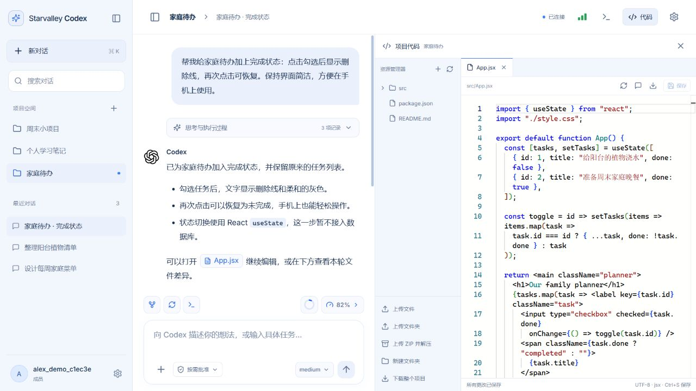
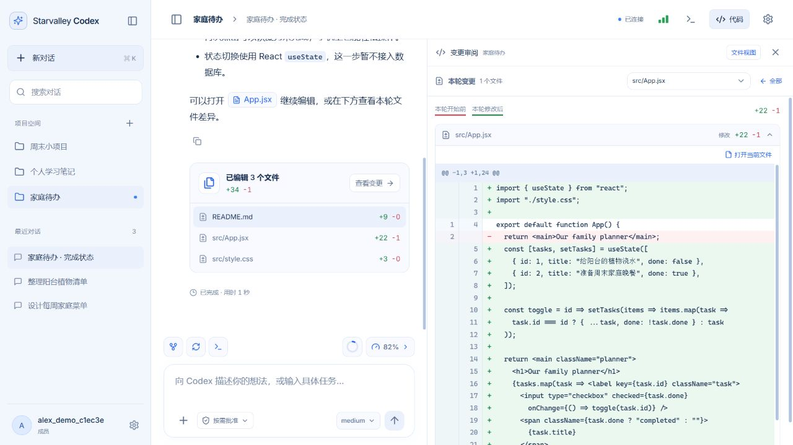
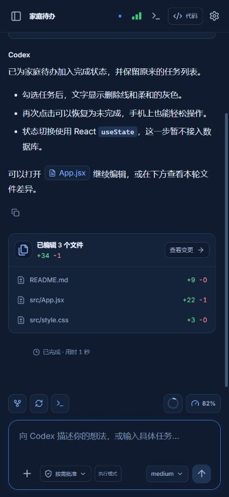

English · [简体中文](README.zh-CN.md)

# Starvalley Codex

### One server. A private Codex workspace for everyone.

A self-hosted Codex web workspace for families, friends, and small trusted groups. Open a browser, pick a project, and turn an idea into working code—sharing one server, with a separate space for each member.

[](LICENSE)
[](package.json)
[](compose.yml)

[Quick start](#quick-start) · [Why Starvalley](#why-starvalley) · [See it in action](#see-it-in-action) · [How it works](#how-it-works) · [FAQ](#faq) · [Deployment guide](docs/deployment.md)



*The real web interface, captured locally with fictional projects and simulated Codex responses. The current interface uses Chinese labels; this repository provides English and Chinese documentation.*

---

Deploy Starvalley once for your household. One person can work on a family planner, another can learn Python, and another can build a weekend project. Each logs in to their own workspace and connects their own Codex account. Projects and conversations stay on the server, ready to continue from another browser.

The browser combines streaming chat, a code editor, file transfers, a terminal, and change review. The official Codex CLI runs on your server through its [App Server protocol](https://learn.chatgpt.com/docs/app-server).

## Why Starvalley

| What matters | What you get |
| --- | --- |
| A shared home for your coding group | One deployment and one URL, with invitation-based registration and individual logins. |
| A space of your own | Separate projects, conversations, Codex configuration, credentials, and history for each member. |
| Development from a browser | Ask Codex, edit with Monaco, run terminal commands, and inspect changes in one workspace. Members need no local CLI installation. |
| Control over the server | Docker deployment, persistent local data, configurable worker limits, account roles, and usage visibility. |
| A smooth everyday workflow | Streaming responses, reconnecting WebSockets, recoverable conversation history, light/dark themes, and a layout that adapts to phones. |
| Your own look | [Wallpaper-driven skins](docs/appearance.md), Codex-assisted colors, reusable presets, and independent desktop/mobile appearance. |

Workspaces are private between ordinary members. The deployment operator controls the host and can access stored data; see [the isolation boundaries](docs/deployment.md#isolation-and-permissions).

## Quick start

You need a **Linux server with Docker Engine and Docker Compose**, Git, a domain with HTTPS, and Codex access for each member. The worker image includes Codex CLI; Node.js 24+ is needed on the host only for local development or the optional deployment scripts.

### 1. Get the source

```bash
git clone https://github.com/zjgsuzjx/web-codex-server.git
cd web-codex-server
```

### 2. Configure and start

Follow the [deployment guide](docs/deployment.md#first-deployment) to create your private `.env`, prepare the data directory, and configure HTTPS and WebSocket forwarding. It includes a generic setup for your own domain and server path.

Once configuration and data permissions are ready:

```bash
docker build -f Dockerfile.worker -t starvalley-codex-worker:local .
docker compose build web
docker compose up -d --wait
```

The web container listens on `127.0.0.1:3100`; your reverse proxy exposes the HTTPS site.

### 3. Create your group

1. Open your site and register with the bootstrap invite from your private `.env`. The first account becomes the super administrator; register it yourself before sharing access.
2. In **Settings → Codex account** (`设置 → Codex 账号`), connect your own ChatGPT account through the official device authorization page, or configure your own API key. Device authorization must be enabled for the account or workspace. See [OpenAI authentication](https://learn.chatgpt.com/docs/auth).
3. Create a project and start a conversation.
4. In **Settings → Personal account** (`设置 → 个人账号`), create individual, single-use invitations for family members or friends. Each invited member gets their own workspace and connects their own account.

## See it in action

### From an idea to an editable project

Ask Codex to explain code, build a feature, or fix a bug. Follow the streamed response, approve actions when requested, and answer clarifying questions in step-by-step cards. Open file references directly in the editor, save with `Ctrl+S`, or switch to the web terminal for CLI workflows.

Conversations support history, branching, and context compaction. Model and reasoning controls, plan mode, approval settings, and advanced `config.toml` configuration are available in the web interface.

### See what changed

Each task shows changed files and added/deleted line counts. Open the review panel to inspect individual patches with before/after line numbers, then open the current file to keep editing.



*Changes are measured against a snapshot at the start of the task, including shell writes. Concurrent manual edits also count; oversized or binary files can have unknown line counts.*

### Bring your files; take your work with you

Upload files, folders, or ZIP archives into a project. All uploads use acknowledged binary WebSocket chunks, with reconnect recovery within the same page. Folders preserve their structure. Download individual files in their original format, or export folders and whole projects as ZIP archives.

Chat attachments stay separate from project files. Add documents, code, or pasted screenshots; preview supported images and text in the conversation. Generated images can be previewed and downloaded when the selected model and account support them.

In **Settings → Personal account**, upload a JPG, PNG, or WebP image (up to 5 MB, 16 million pixels, and 8192 pixels per side). Drag and zoom to crop it; the avatar is saved to your account as a 256 × 256 PNG, up to 256 KB. You can restore the default avatar at any time. Signing in or reloading shows your avatar, a personal welcome, and the workspace connection status, with reduced-motion support.

### Keep an eye on work from your phone

The mobile layout keeps chat and task controls accessible, with a collapsible sidebar and light/dark themes. Usage details show available Codex quota windows, reset times, storage, and server capacity. Connection bars report the browser-to-server WebSocket latency. A tab badge indicates completed tasks while the page remains connected in the background.



*All screenshots use synthetic demo data. Displayed quota, timings, and responses are illustrative.*

## How it works

```text
Family members / friends
          │ HTTPS + WebSocket
          ▼
  Reverse proxy → Web gateway + SQLite
                           │
                 ┌─────────┼─────────┐
                 ▼         ▼         ▼
              Member A  Member B  Member C
              worker    worker    worker
              projects  projects  projects
              Codex     Codex     Codex
              history   history   history
```

The React frontend talks to a Node.js gateway. The gateway checks account and project ownership, persists application state in SQLite, and manages a separate Docker worker for each active user. Each worker runs the official Codex CLI and mounts that user's projects and Codex directory. Workers are created on demand and stop after idle periods; the active-worker limit controls concurrency.

The default worker runs as UID 1000 with a read-only root filesystem, dropped Linux capabilities, and no Docker socket or host namespace access. With the default sandbox configuration, Codex and the terminal can access **all projects and the Codex directory belonging to that user**. The gateway itself has Docker socket access and is a trusted management service.

## FAQ

**Does a family group share one ChatGPT subscription?**

Each member connects their own eligible ChatGPT account or API key. Sharing the server does not combine quotas or grant subscription access. Model availability and limits depend on the connected account or provider.

**Can members see each other's projects?**

The application checks user, project, conversation, and file ownership, and ordinary workers mount only their owner's directories. Collaborative shared projects and real-time co-editing are not currently implemented. The server operator can access host data; this is a service for a trusted group.

**Can I deploy it for other people?**

Yes. Use your own server, domain, and invitations for a group you trust. Keep registration invite-only, configure HTTPS, and size worker resources for your users. The [deployment guide](docs/deployment.md) covers configuration, backups, permissions, and the existing deployment scripts' installation-specific assumptions.

**Is every Codex CLI feature available as a web button?**

The web interface covers the main coding workflow. Use the built-in terminal for CLI functionality without a dedicated web control. CLI compatibility is pinned in [Dockerfile.worker](Dockerfile.worker); test protocol changes before upgrading it.

**What should I know before hosting?**

Members have a 1 GiB storage allowance, admins 5 GiB, and superadmins no application limit. At 90% usage, a persistent warning points to file management. Codex-assisted cleanup lists candidate files with sizes and purposes for selection before deletion; manual deletion works without model quota. The file viewer supports resizable panes, Ctrl/Cmd multi-selection, bulk size/deletion, and common image formats.

Application storage quotas apply to web uploads and editor saves; Codex and terminal writes need host-level disk monitoring. Disabling a worker's network also blocks model/API connections. Optional host execution grants actual host root access and is disabled by default. See [operational limits](docs/deployment.md#operational-limits).

## Development and contributing

With Node.js 24+:

```bash
npm ci
npm run build
npm start
```

Open `http://localhost:3100`. Account and file features can be developed on Windows; real Codex workers require Linux Docker. For frontend hot reload and production setup, see the [deployment and development guide](docs/deployment.md#local-development).

Before proposing code changes, run `npm run check`, `npm test`, and `npm run build`. Linux runs additional filesystem and deployment checks. Automated tests and protocol smoke checks do not replace a real authenticated model conversation.

Bug reports, deployment feedback, and documentation improvements are welcome through [issues](https://github.com/zjgsuzjx/web-codex-server/issues) and [pull requests](https://github.com/zjgsuzjx/web-codex-server/pulls). Include reproducible steps and remove credentials and private project data.

## License

[Apache License 2.0](LICENSE). Starvalley Codex is an independent project and is not affiliated with or endorsed by OpenAI. Codex, ChatGPT, and the OpenAI Blossom mark belong to OpenAI; third-party tools and services retain their own terms and licenses.
